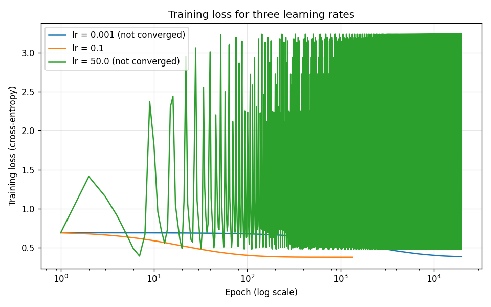

# Level 2 Analysis: CharithReddy007

## Setup

- Data: `datasets/binary_classification.csv`, 500 lunches. Features: `queue_length`, `plate_waste_fraction`, `menu_board_kcal`, `handwriting_neatness`. Target: `good_lunch`.
- Split: shuffled with seed 42, 400 train / 100 test (41% good overall, 42% in test).
- Scaling: standardised each feature using the **training** mean and spread only, so no test information leaks into training.
- Model: logistic regression, full-batch gradient descent from zero weights. Gradient and update written by hand (`logistic_regression.py`).
- **Convergence criterion:** stop when the length of the gradient (all weights + bias) is below 1e-4, or after 20,000 epochs. I used the gradient instead of "loss stopped changing" because with a tiny learning rate the loss changes slowly even far from the minimum, which would look falsely converged.

## Results

| | |
|---|---|
| **Test accuracy (lr = 0.1)** | **75.0%** |
| Baseline (always guess "bad") | 58.0% |
| Epochs to converge | 1,340 |
| Time to converge | 0.038 s |

Learned weights (on scaled features):

| Feature | Weight | Meaning |
|---|---:|---|
| queue_length | +1.869 | longer queue → more likely good (people queue for good food) |
| plate_waste_fraction | −1.207 | more food left on plates → more likely bad |
| menu_board_kcal | +0.452 | weak effect |
| handwriting_neatness | +0.268 | weak effect |
| bias | −0.683 | default leans "bad", matching the 58/42 split |

## Learning rates

### Predictions (written before running)

| Learning rate | My prediction |
|---|---|
| **0.001** | Too small. The loss will go down smoothly but very slowly and won't converge within 20,000 epochs. |
| **0.1** | About right. A smooth curve that flattens out and converges in a few thousand epochs. |
| **50** | Too big. Steps will overshoot the minimum, so the loss will jump up and bounce instead of settling, and it won't converge. |

### What happened

| Learning rate | Epochs | Converged? | Final loss | Train acc | Test acc |
|---|---:|---|---:|---:|---:|
| 0.001 | 20,000 | No | 0.3857 | 83.8% | 76.0% |
| 0.1 | 1,340 | Yes | 0.3796 | 83.5% | 75.0% |
| 50 | 20,000 | No | 0.9801 | 81.0% | 72.0% |

- **0.001: right.** It never converged, and its loss (0.3857) was still above the true minimum (0.3796). One surprise: its test accuracy (76%) is slightly *higher* than the converged model's. That's one lunch out of 100, which is noise. A lower loss on training data doesn't guarantee more correct answers on the test set, and stopping early keeps the weights a little smaller, which can occasionally help.
- **0.1: right**, and faster than I expected: 1,340 epochs instead of "a few thousand".
- **50: right about the bouncing**, but I underestimated how bad it gets. The final loss of 0.98 is *worse* than the 0.693 it started from with all-zero weights. It still gets 72% of test lunches right, because the weights keep pointing roughly the right way even while they swing too far. That's why accuracy alone can hide a broken training run, and the loss curve can't.

## Error analysis

The model gets 25 of 100 test lunches wrong. Only 10 of them are near the boundary (p between 0.35 and 0.65). The other 15 are confidently wrong, so the model isn't just unsure about them.

### Three examples the model gets wrong

| CSV row | queue_length | plate_waste | menu_kcal | handwriting | True | p(good) |
|---|---:|---:|---:|---:|---|---:|
| 63 | 35 | 0.750 | 2319 | 1.2 | good | 0.060 |
| 378 | 16 | 0.343 | 2033 | 3.3 | good | 0.064 |
| 42 | 56 | 0.377 | 2203 | 7.0 | bad | 0.916 |

For comparison, the class averages are queue 48 (good) vs 29 (bad), and plate waste 0.35 (good) vs 0.55 (bad).

All three look like a **typical lunch of the opposite class** on the two features the model trusts most:
- Row 63 has very high plate waste (0.75), so it looks bad, but it was good.
- Row 378 has a very short queue (16), so it looks bad, but it was good.
- Row 42 has a long queue (56) and low waste (0.38), a textbook good lunch, but it was bad.

### Hypothesis

The model leans almost entirely on `queue_length` and `plate_waste_fraction`. These three lunches contradict both, and the other two features are too weak to rescue them. In particular, `handwriting_neatness` looks like it carries **no information**: its average is 5.17 for good lunches and 5.13 for bad, practically identical. If that's true, it only adds noise, and removing it should not hurt and might help slightly.

### Test

Retrain with each feature removed in turn (same split, lr = 0.1):

| Model | Test accuracy |
|---|---:|
| All four features | 75.0% |
| Without queue_length | 58.0% (same as always guessing "bad") |
| Without plate_waste_fraction | 67.0% |
| Without menu_board_kcal | 74.0% |
| **Without handwriting_neatness** | **76.0%** |

### Did it help?

**Partly.** Removing `handwriting_neatness` didn't hurt and nudged accuracy up by one lunch (75 → 76%), which supports the idea that it's a misleading feature with no real signal. Its +0.268 weight was the model fitting noise in the training set. But one lunch out of 100 is too small a change to call a real improvement.

The more important result is the other side of the hypothesis. Without queue length, the model is no better than guessing. This confirms that it rests almost entirely on queue length and plate waste. Lunches like rows 63, 378 and 42, which go against those two features, can't be fixed by dropping a feature. They would need information the dataset doesn't have (for example, what was actually served), or they may simply be noisy labels.

## AI disclosure

I used Claude to help write `logistic_regression.py`, the teaching notebook and this analysis. I ran everything on the real data myself, and I can explain the gradient, the update step, the convergence criterion and every result above.
