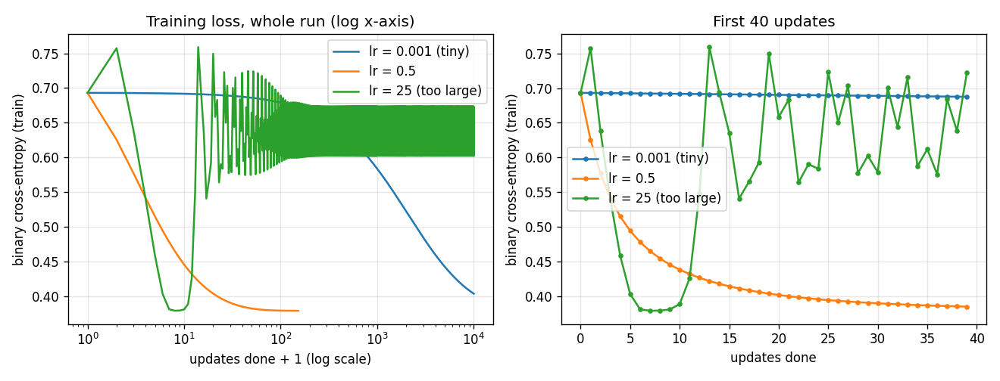

# Level 2: Logistic regression by gradient descent (Fearless2389)

Predicting `good_lunch` (1 = good) from `queue_length`, `plate_waste_fraction`,
`menu_board_kcal` and `handwriting_neatness` with logistic regression that I train
myself using batch gradient descent (NumPy only, no scikit-learn).

## Predictions (made before running)

Written before any training code was run. The only thing I had looked at was the
summary table of the data (column ranges, and that 204 of 500 lunches are "good", so
always guessing "not good" would already score about 59%).

Setup the predictions refer to: features standardized with train-set mean/std, weights
start at zero (so the starting loss is ln 2 = 0.693), batch gradient descent, stop when
the loss changes by less than 1e-6 between iterations or after 10,000 iterations.

| Learning rate | What I predict |
|---|---|
| **0.001** (tiny) | The loss goes down smoothly but very slowly, an almost straight gentle slope from 0.693. It will **not** meet the convergence criterion before the 10,000-iteration cap and will finish with a clearly higher loss than the other two. Test accuracy a little lower than the good rate, but still well above 59%, because even a half-trained model points its weights in the right direction. |
| **0.5** (good) | Fast, smooth drop in the first ~100 iterations, then flattens. Converges well before the cap (a few hundred to about 1,000 iterations, well under a second). This is the run I will report test accuracy for; my guess is roughly 80-90%. |
| **25** (too large) | The steps overshoot. The loss will zig-zag / spike in the first iterations (possibly going above 0.693) instead of decreasing smoothly. Because the sigmoid's gradient is bounded I do not expect it to blow up to infinity, but I expect it to keep oscillating and either not converge or converge much later than 0.5, ending at a worse loss. |

## How to run

From any folder (paths are resolved relative to the script):

```
pip install numpy pandas matplotlib
python Level_2/Fearless2389/logistic_regression.py
```

It prints the learning-rate table, saves `loss_curves.png` next to the script, and prints the
error analysis used in `analysis.md`. It takes about 2 seconds. The teaching notebook is
`teaching_notebook.ipynb` (open it in Jupyter or VS Code and run all cells).

| File | What it is |
|---|---|
| `logistic_regression.py` | sigmoid, loss, gradient, update loop, experiments (NumPy + pandas + matplotlib only) |
| `loss_curves.png` | training loss for the three learning rates |
| `analysis.md` | error analysis: 3 mistakes, one hypothesis, one test |
| `teaching_notebook.ipynb` | step-by-step teaching version of the model |

## Results

- **Split:** 80/20 train/test, shuffled with `numpy.random.default_rng(42)` (400 train rows, 100 test rows).
- **Scaling:** z-score with the mean and std of the 400 **training** rows only, then applied
  unchanged to the test rows (so nothing about the test lunches leaks into training).
- **Convergence criterion:** stop when `|loss_t - loss_(t-1)| < 1e-6` (training loss), otherwise stop after 10,000 updates.
- **Final model (lr = 0.5): test accuracy 0.750 (75 / 100)**, converged after **151 updates in under 10 ms**
  wall-clock (6-10 ms across my runs; it varies with what else the laptop is doing). Final training loss 0.3796.
- For comparison, always guessing "not good" scores 0.580 on this test set.

| lr | updates | converged? | wall-clock | final train loss | test accuracy |
|---|---|---|---|---|---|
| 0.001 | 10,000 (cap) | no | ~0.5 s | 0.4042 | 0.760 |
| 0.5 | 151 | yes | ~6-10 ms | 0.3796 | 0.750 |
| 25 | 10,000 (cap) | no | ~0.5 s | 0.6027 | 0.680 |



Learned weights (lr 0.5, standardized features): queue_length +1.85, plate_waste_fraction -1.19,
menu_board_kcal +0.45, handwriting_neatness +0.26, bias -0.68. Long queues mean a good lunch, lots of
food left on plates means a bad one.

**Is the 1e-6 criterion stopping too early?** I checked by rerunning lr 0.5 with a tolerance of 1e-12:
it runs 451 updates, the training loss is only 2.1e-5 lower, and the test accuracy stays 0.750.
So 1e-6 is a fair "done" point here (the script prints this check).

**How much should 75% be trusted?** One 100-row test set is small: one lunch = 1 percentage point.
Repeating the whole pipeline on 20 other seeds (0-19) gives a mean test accuracy of 0.814 (range 0.75 to 0.88),
so seed 42 is as hard as the hardest of those splits. I still report 0.750 because seed 42 is the split I fixed
before looking (the script prints this check too).

## Predictions vs what actually happened

| lr | Prediction | Actual | Right? |
|---|---|---|---|
| 0.001 | slow smooth decrease, does not converge in 10,000 updates, higher final loss, accuracy a bit lower than lr 0.5 | smooth and slow, hit the cap without converging, final loss 0.4042 (vs 0.3796). Not a straight line though: it is the same bent curve as lr 0.5, stretched out about 500 times (0.5 / 0.001), so 10,000 tiny steps cover about what 20 steps of lr 0.5 do | **Mostly right.** Wrong on the shape (curved, not straight) and on accuracy: it scored 0.760, one lunch *better* than lr 0.5. |
| 0.5 | fast smooth drop, converges in a few hundred to ~1,000 updates, accuracy 80-90% | smooth, converged in 151 updates (under 10 ms), accuracy 0.750 | **Right on behaviour, wrong on accuracy** (75%, not 80-90%). |
| 25 | overshoots, zig-zags, does not blow up, does not converge, worse loss | zig-zags from the very first step (loss jumps to 0.757), does not blow up, never converges, ends in a 2-step back-and-forth between loss 0.6027 and 0.6734, accuracy 0.680 | **Right**, with one surprise (below). |

**Why the wrong predictions were wrong**

1. *lr 0.001 beating lr 0.5 on accuracy.* Accuracy only asks which side of 0.5 each probability falls on.
   The slow run's weights point in nearly the same direction as the converged ones, just smaller (cosine
   similarity 0.999), so the decision boundary is almost the same line. The two models disagree on exactly one
   borderline test lunch, and the slow one happened to get it right. The loss, which looks at the actual probabilities, still
   says the converged model is better (0.3796 vs 0.4042 on train). A 1-lunch difference is noise, not a sign
   that under-training helps.
2. *75% instead of 80-90%.* I guessed without knowing how much the classes overlap. They overlap a lot (the
   best possible training loss is 0.38, far from 0), and the 20-seed check above shows my seed-42 test split is
   as hard as the hardest of 20 other splits; the average split gives 81%, inside my guessed range. So the guess was reasonable for
   the data, but this particular split is unlucky.
3. *The lr 25 surprise.* I expected it to bounce from the start and stay bad. Instead, in the first 10 updates
   it reached almost the best possible loss (0.380 at update 7-8, see the right panel), *then* became unstable
   and settled into a permanent zig-zag. My understanding: near a minimum, each update multiplies the error
   along a direction of the loss bowl by about (1 - lr x curvature in that direction). Gradient descent is only
   stable if lr < 2 / (largest curvature). The script computes the largest curvature (biggest eigenvalue of the Hessian)
   for this data: about 0.32 at the start (limit lr < 6) and 0.13 at the best weights (limit lr < 15). lr 25 is
   over both limits, so along the steepest direction the error is multiplied by about |1 - 25 x 0.13| = 2.3 every
   step, while the gentler directions still get fixed quickly. That is why the loss first dips (gentle directions
   fixed in a few big steps) and then the steep-direction error, which started tiny, grows until it dominates
   around update 10. It does not go to infinity because once predictions get extreme the sigmoid flattens and the
   curvature drops, so the weights end up jumping between two points on opposite sides of the valley forever.
